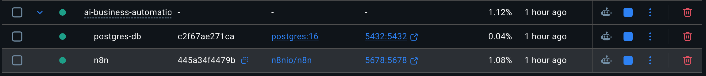

# AI Business Automation Platform

AI-powered support ticket analysis with n8n, OpenAI, PostgreSQL and Docker.

A customer message is sent to a webhook. An LLM classifies it by category, priority and summary, and the structured result is stored in PostgreSQL for later analytics and reporting.


---

## Workflow Architecture

```
Webhook (POST /ticket-analysis)
   ↓
OpenAI – Message a model        → classifies the ticket, returns JSON
   ↓
Code in JavaScript              → cleans and parses the LLM output
   ↓
PostgreSQL – Insert rows        → stores category, priority, summary, message
```

| Node | Purpose |
|---|---|
| **Webhook** | Receives support requests as JSON (`{"message": "..."}`) via HTTP POST |
| **Message a model** | Sends the message to OpenAI with a prompt that requests a strict JSON response |
| **Code in JavaScript** | Removes Markdown code fences, parses the JSON and appends the original message |
| **Insert rows in a table** | Writes the structured ticket into PostgreSQL |

---

## Handling unreliable LLM output

Even with the instruction *"Return ONLY valid JSON"*, the model sometimes wraps its answer in a Markdown code fence (` ```json ... ``` `). Passing that directly to `JSON.parse` would break the workflow. The Code node therefore cleans the response before parsing:

```javascript
const raw = $input.first().json.output[0].content[0].text;
const cleaned = raw.replace(/```json/g, '').replace(/```/g, '').trim();
const parsed = JSON.parse(cleaned);

// Add the original message from the webhook
parsed.message = $('Webhook').first().json.body.message;

return [{ json: parsed }];
```

---

## Prompt

```
Analyze this customer support request.
Return ONLY valid JSON in this format:
{ "category": "", "priority": "", "summary": "" }

Customer message: {{$json["body"]["message"]}}
```

---

## Example

**Request**

```bash
curl -X POST http://localhost:5678/webhook-test/ticket-analysis \
  -H "Content-Type: application/json" \
  -d '{"message": "Meine Bestellung #4711 ist seit 10 Tagen nicht angekommen und der Kundenservice antwortet nicht. Ich brauche das Paket dringend!"}'
```

**Stored result**

```json
{
  "category": "Delivery Issue",
  "priority": "High",
  "summary": "Order #4711 has not arrived after 10 days and customer service is unresponsive. Customer urgently needs the package.",
  "message": "Meine Bestellung #4711 ist seit 10 Tagen nicht angekommen ..."
}
```

German input is classified correctly and summarized in English, so tickets end up in one consistent format.

---

## Tech Stack

- n8n (workflow automation)
- OpenAI API
- JavaScript
- PostgreSQL 16
- Docker / Docker Compose

---

## Setup

1. Start the containers:

   ```bash
   docker compose up -d
   ```

2. Open n8n at http://localhost:5678 (use Chrome or Firefox; Safari blocks the session cookie on plain HTTP).
3. Add your own OpenAI and PostgreSQL credentials in n8n.
4. Open the workflow, click **Execute workflow** and send a test request with the `curl` command above.

> The `/webhook-test/` URL only works while the workflow is waiting for a test event. After publishing, use `/webhook/ticket-analysis`.

---

## Future Improvements

- Power BI dashboard on top of the ticket table (volume by category, share of high-priority tickets)
- Response node that returns the classification directly to the caller
- Fixed category list in the prompt for more consistent labels
- Error branch for invalid LLM output

---

## Screenshots

### Database


### Docker Containers



---

## Author

Niklas Ringeisen · [GitHub](https://github.com/Niklasr06) · [LinkedIn](https://www.linkedin.com/in/niklas-ringeisen-77973228a/)
