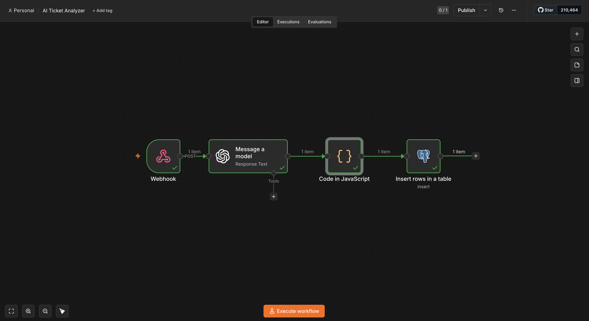
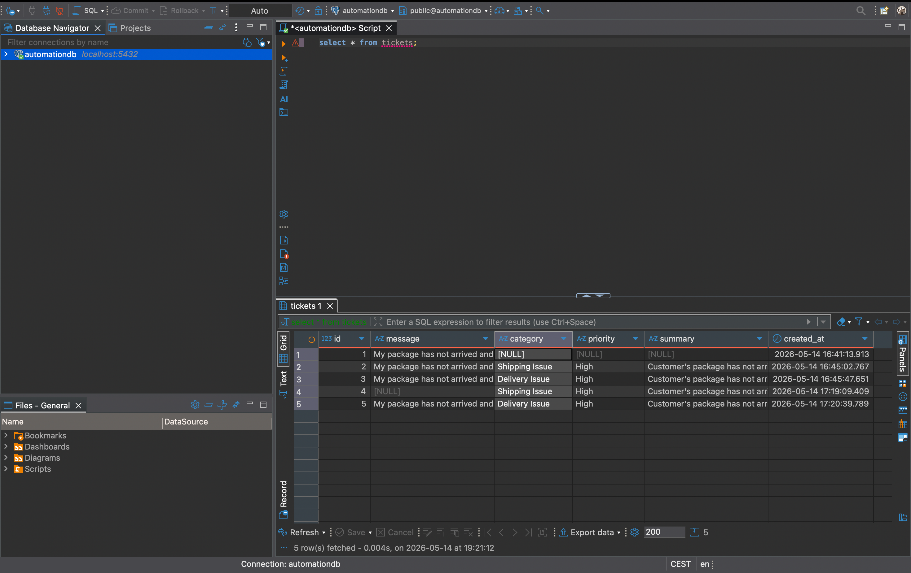

# AI Business Automation Platform

AI-powered support ticket analysis with n8n, OpenAI, PostgreSQL and Docker.

A customer message is sent to a webhook, an LLM classifies it by **category**, **priority** and **summary**, and the result is stored in PostgreSQL.



---

## Workflow

```
Webhook  →  OpenAI  →  JavaScript (JSON cleanup)  →  PostgreSQL
```

1. **Webhook** receives a support message
2. **OpenAI** analyzes it and returns JSON
3. **JavaScript** cleans the response and parses it
4. **PostgreSQL** stores the structured ticket

---

## Example

**Input**

```json
{ "message": "Meine Bestellung #4711 ist seit 10 Tagen nicht angekommen. Ich brauche das Paket dringend!" }
```

**Output**

```json
{
  "category": "Delivery Issue",
  "priority": "High",
  "summary": "Order #4711 has not arrived after 10 days. Customer urgently needs the package."
}
```

---

## Tech Stack

n8n · OpenAI API · JavaScript · PostgreSQL · Docker

---

## Setup

```bash
docker compose up -d
```

Open n8n at http://localhost:5678, add your OpenAI and PostgreSQL credentials and run the workflow.

---

## Screenshots

### Database



### Docker Containers


---

## Author

Niklas Ringeisen · [GitHub](https://github.com/Niklasr06) · [LinkedIn](https://www.linkedin.com/in/niklas-ringeisen-77973228a/)

Built with AI assistance (Claude).
